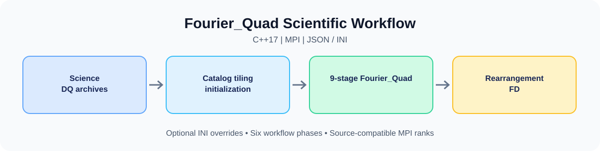

# 🌌 Fourier_Quad Pipeline

An end-to-end, MPI-parallel implementation of the **Fourier_Quad (FQ)** weak gravitational lensing shear measurement framework for wide-field CCD surveys. The repository contains two **independently operated scientific implementations**: a C++17 pipeline in [`cpp_Standard/`](cpp_Standard/) and a Fortran77 pipeline in [`f77/`](f77/). Both use Fourier-space shear estimation and PSF modeling, but have **different configuration, preprocessing, and launching contracts**.

---

## ✨ Key Features

- **Rigorous Fourier-Space Shear Estimation** — Fourier_Quad measures shear from two-dimensional Fourier power spectra, with PSF treatment and noise-bias correction.
- **Excellent Computing Efficiency** — The processing speed for a single source reaches the order of $10^{-4}s$.
- **Distributed MPI Execution** — The C++ program integrates catalog preparation, archive initialization, nine-stage measurement, spatial rearrangement, and optional field-distortion calibration; the Fortran77 program processes existing exposure lists using nine compile-time-selected stages.
- **Comprehensive Scientific Branches** — Configurable PSF modeling, background/noise handling, DQ masks, external catalog matching, and calibration options.
- **Workstation & HPC Container Readiness** — Independent Python JSON launchers (`cpp_docker/fqctl.py` and `f77_docker/fqctl.py`) support Docker workstations and Slurm + Apptainer clusters. Their JSON schemas and runtime arguments are **not interchangeable**.

---

## 🗂️ Documentation Index

Choose **one implementation** to begin. Each column below links to a self-contained English documentation system.

| Section | C++ Standard (`cpp_Standard/`) | Fortran77 (`f77/`) |
| :--- | :--- | :--- |
| **Documentation Home Page** | [Home C++](doc/cpp/README.md) | [Home F77](doc/f77/README.md) |
| **Quick Start & Essential Configuration** | [C++ Configuration](doc/cpp/CONFIGURATION.md) | [F77 Configuration](doc/f77/CONFIGURATION.md) |
| **Environment & Dependencies** | [C++ User Guide](doc/cpp/CPP_GUIDE.md#environment-and-dependencies) | [F77 User Guide](doc/f77/F77_GUIDE.md#environment-and-dependencies) |
| **Data Preparation** | [Science/DQ, Gaia and External Catalogs](doc/cpp/DATA_PREPARATION.md) | [Exposure Lists and Prepared FITS](doc/f77/DATA_PREPARATION.md) |
| **Configuration Reference** | [C++ INI and Compiled Parameters](doc/cpp/CPP_PIPELINE_PARAMETERS.md) | [F77 Compile-Time Parameters](doc/f77/F77_PIPELINE_PARAMETERS.md) |
| **Native Build & Run** | [C++ Build and Execution](doc/cpp/CPP_GUIDE.md#build-and-run) | [F77 Build and Execution](doc/f77/F77_GUIDE.md#build-and-run) |
| **Docker Workstation** | [C++ Docker](doc/cpp/DOCKER.md) | [F77 Docker](doc/f77/DOCKER.md) |
| **Container Paths** | [C++ JSON Mount/INI Mapping](doc/cpp/PATHS.md) | [F77 JSON Mount/Compiled Path Mapping](doc/f77/PATHS.md) |
| **Slurm + Apptainer** | [C++ HPC Runner](doc/cpp/HPC.md) | [F77 HPC Runner](doc/f77/HPC.md) |
| **Third-Party Notices** | [C++ Dependencies](doc/cpp/THIRD_PARTY_NOTICES.md) | [F77 Dependencies](doc/f77/THIRD_PARTY_NOTICES.md) |

The optional standalone [dataset initializer](init_program/README.md) can prepare Science and DQ archives for pipelines that consume an exposure-list tree. It has its own Python/Astropy/MPI requirements.

---

## 📚 Citations & References

If you use the scientific software or its products, cite the relevant foundational Fourier_Quad publications:

1. **Foundational Fourier_Quad Method:**
   > **Zhang, J.** (2008), *"Measuring the cosmic shear in Fourier space"*, **Monthly Notices of the Royal Astronomical Society (MNRAS)**, 383(1), 113–118.
   > DOI: [10.1111/j.1365-2966.2007.12585.x](https://doi.org/10.1111/j.1365-2966.2007.12585.x) · arXiv: [astro-ph/0612146](https://arxiv.org/abs/astro-ph/0612146)

2. **Faint-Source Noise Correction & Power-Spectrum Formalism:**
   > **Zhang, J., Luo, W., & Foucaud, S.** (2015), *"Accurate Shear Measurement with Faint Sources"*, **Journal of Cosmology and Astroparticle Physics (JCAP)**, 2015(01), 024.
   > DOI: [10.1088/1475-7516/2015/01/024](https://doi.org/10.1088/1475-7516/2015/01/024) · arXiv: [1312.5514](https://arxiv.org/abs/1312.5514)

3. **PDF Symmetrization & Field-Distortion Shear Calibration:**
   > **Zhang, J., Dong, F., Li, H., et al.** (2019), *"Testing Shear Recovery with Field Distortion"*, **The Astrophysical Journal (ApJ)**, 875(1), 48.
   > DOI: [10.3847/1538-4357/ab1080](https://doi.org/10.3847/1538-4357/ab1080) · arXiv: [1808.02593](https://arxiv.org/abs/1808.02593)

---

## ⚖️ License & Versioning

- **Open-Source License:** Repository-authored code, scripts, and documentation are distributed under the [MIT License](LICENSE) (Copyright © 2026 Jun Zhang and Syoong-s).
- **Third-Party Software:** Scientific libraries and container dependencies retain their respective upstream licenses; consult the [C++ notices](doc/cpp/THIRD_PARTY_NOTICES.md) and [F77 notices](doc/f77/THIRD_PARTY_NOTICES.md).
- **Reproducibility:** Use a fixed commit or [GitHub Release](https://github.com/Syoong-s/Fourier_Quad_Pipeline/releases). Record the selected implementation, compiler/container image, runtime JSON or INI, edited headers, and input catalogs with scientific outputs.
