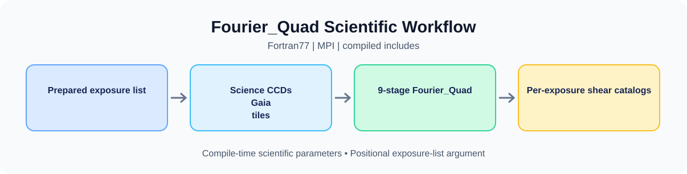

# 🛠️ Fortran77 Pipeline User Guide

[Home](../../README.md) · [Essential Configuration](CONFIGURATION.md) · [Data Preparation](DATA_PREPARATION.md) · [Parameters](F77_PIPELINE_PARAMETERS.md) · [Docker](DOCKER.md) · [HPC](HPC.md)

This is the primary guide for the native Fortran77 program in [`f77/`](../../f77/). Docker and Apptainer are optional ways to obtain the scientific toolchain; the compiled program itself still uses a **positional exposure-list argument**.



---

## Environment and Dependencies

| Requirement | Native installation | Reference image toolchain |
| :--- | :--- | :--- |
| MPI Fortran compiler | `mpif77`, compatible MPI runtime | GNU Fortran 4.8.5 + MPICH 4.1.2 |
| FITS I/O | CFITSIO headers and library | CFITSIO 4.3.1 |
| Linear algebra | LAPACK + BLAS | LAPACK 3.8.0 and reference BLAS |
| Fourier routines | Bundled `FFTPACK.f` | Built with the scientific program |
| Operating system | 64-bit Linux | `linux/amd64`, Rocky Linux 8.10 |

The reference toolchain is defined by `f77_docker/Dockerfile`. A native host must provide a compiler/MPI implementation compatible with the source and link dependencies. Fortran77 code uses fixed-format conventions and large static arrays; replacing the compiler can require careful compatibility testing.

## Configuration

The primary configuration files are **compile-time include files**, not runtime INI:

| File | Purpose |
| :--- | :--- |
| `f77/para.inc` | Gaia/source paths, PSF branch selectors, stage product, image limits, noise/detection thresholds, catalog columns |
| `f77/cust_para.inc` | Camera dimensions, CCD count, PCA-related and work-parallelism limits |
| `f77/sig_para.inc` | F6 background/noise plane estimator constants |
| `f77/path_layout.inc` | Relative names of FITS, stamps, astrometry, results and exposure products |

Start with [Essential Configuration](CONFIGURATION.md). Changing an include requires a full rebuild. The JSON container launcher can stage a separate source copy and override **path constants** in its `para.inc`; it does not modify numeric scientific branch constants.

## Build and Run

### 1. Compile the executable

```bash
make -C f77 clean
make -C f77 \
  LAPACK_LIB_DIR=/opt/science/lib \
  CFITSIO_LIB_DIR=/opt/science/lib \
  CFITSIO_LIB=/opt/science/lib/libcfitsio.so
```

The Makefile invokes `mpif77`, includes the bundled fixed-format `.f` modules, and links `-llapack -lblas` and CFITSIO. Some default Makefile paths are site-specific, so provide explicit values on your own host. A modern gfortran may require compatibility options that GNU Fortran 4.8.5 does not recognize; do not apply version-specific flags blindly.

### 2. Launch with MPI

```bash
mpirun -np 4 ./f77/Fourier_Quad_Pipe /absolute/path/to/expo_gband.list
```

`main.f` reads the first application argument as the top-level exposure-list path, then distributes exposure work across ranks. It does not support C++-style `--config`, JSON or INI parsing. JSON is interpreted by `f77_docker/fqctl.py` **outside** the Fortran executable.

### 3. Nine-stage scientific pipeline

The compiled `PROCESS_stage` integer is the product of enabled prime factors:

| Stage | Prime | Main routine | Scientific operation |
| :---: | :---: | :--- | :--- |
| 1 | 2 | `pre_process` | FITS/DQ/flat preprocessing and noise background |
| 2 | 3 | `proc_astrometry` | Gaia-based astrometric calibration |
| 3 | 5 | `proc_source` | Source detection, deblending, stamps |
| 4 | 7 | `proc_FourierT_st1` | First Fourier transform phase |
| 5 | 11 | `proc_PSF` | Exposure PSF modeling (with optional `PSF_Ms` reconstruction) |
| 6 | 13 | `proc_FourierT_st2` | Second Fourier transform phase |
| 7 | 17 | `proc_shear` | Fourier_Quad shear moments |
| 8 | 19 | `proc_info` | Exposure diagnostics/statistics |
| 9 | 23 | `proc_comb` | Combine per-exposure shear products |

The default enables all nine stages. Only remove a prime factor when the required upstream intermediate products already exist and the changed stage product has been scientifically verified.

### 4. Output products

Fortran77 derives per-exposure output paths from the input Science FITS location and the compiled `path_layout.inc` directory names. Typical products include `stamps/`, `astrometry/`, `result/<exposure>_all.cat`, and exposure-level summary information. Input archives should remain separate from the writable processing tree. Consult [Data Preparation](DATA_PREPARATION.md) for expected hierarchy.

## Troubleshooting

| Symptom | Action |
| :--- | :--- |
| Program aborts at argument parsing | Supply a valid top-level exposure-list file as the first positional argument. |
| Exposure list is readable but FITS files are missing | Check **paths inside both levels** of lists, and MPI/shared filesystem visibility. |
| Gaia/star match failures | Validate large-tile filenames, headers, RA/Dec coverage, and `ASTROMETRY_CAT`. |
| Invalid or missing masks | Check Science-to-DQ pairing by physical `CCDNUM` and compiled `include_Mask`. |
| Compiler or link errors | Verify `mpif77`, CFITSIO and LAPACK paths and ABI compatibility. |
| Containerized paths do not resolve | Configure `f77_docker/project.json` using [Container Paths](PATHS.md). |
| Changed `.inc` file has no effect | Recompile; for containers, reconfigure the isolated source snapshot and rebuild. |

For converting archives into prepared CCDs and exposure lists, use the [standalone dataset initializer](../../init_program/README.md).
